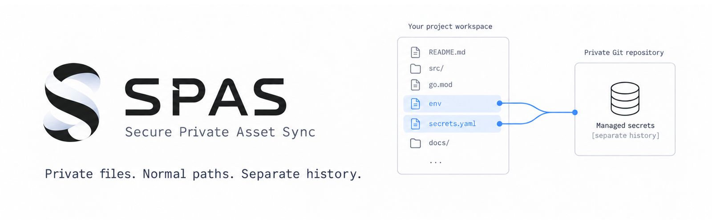
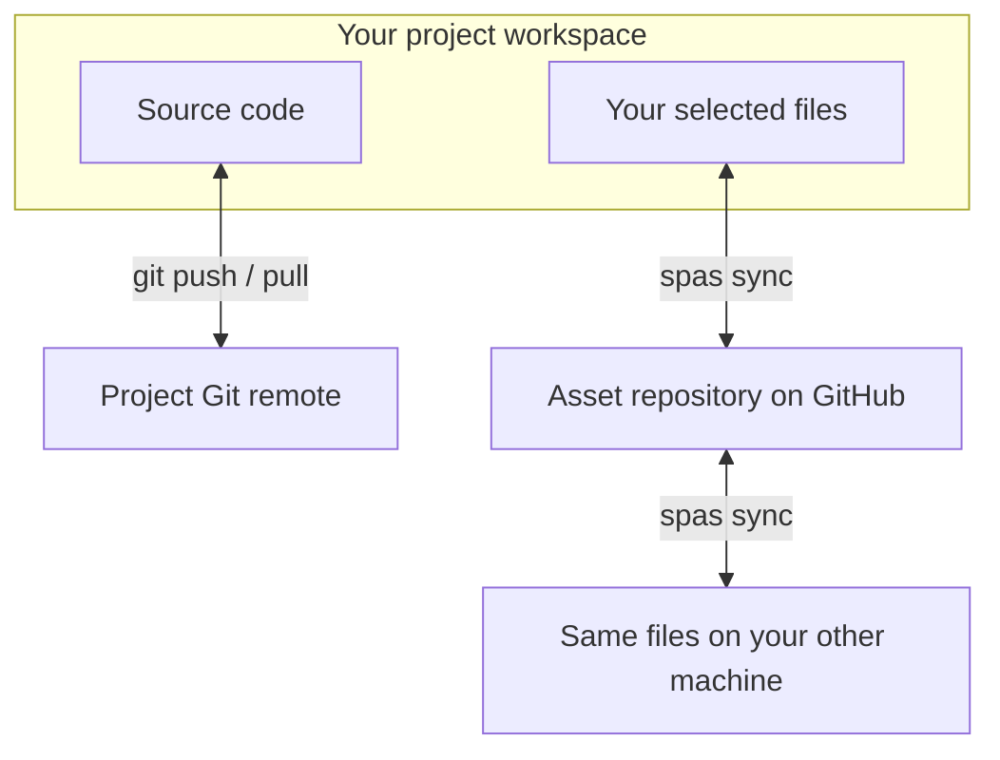

<div align="center">



# SPAS: Secure Private Asset Sync

**Private files. Normal paths. Separate history.**

[](https://github.com/getspas/spas/releases/latest)
[](https://github.com/getspas/spas/actions/workflows/ci.yml)

[**Install SPAS**](#installation) · [Quick start](#quick-start) · [How it works](#how-it-works) · [Wiki](https://github.com/getspas/spas/wiki) · [Discussions](https://github.com/getspas/spas/discussions)

</div>

SPAS (pronounced **"/spæz/"**) keeps the files you don't commit at their normal
project paths and syncs them across your machines through a separate GitHub
repository. Your local setup gets its own Git history, and your tools keep
finding files where they expect them.

## Why SPAS?

Your project has more than source code. Maybe it's a local config, a set of API
mocks, or notes you'd like to pick up on your other laptop. Choose those files
once, then run `spas sync` when you're ready to exchange changes.

| Keep your workflow | What SPAS handles |
| :--- | :--- |
| Use the same file paths | Files stay in your workspace, where your editor, scripts, and tests expect them |
| Keep personal files out of project history | Local rules in `.git/info/exclude` keep selected files untracked; `.gitignore` stays unchanged |
| Keep a history of your local setup | A separate GitHub repository records commits and merges |
| Choose what travels with you | Enroll individual files or the current files in a directory; sync when you ask |

Use it for **local configs, test fixtures, personal notes, editor settings, helper
scripts, or your own AI instructions**. These are examples; SPAS manages supported
regular files containing text or binary data.

## Installation

SPAS runs on **Windows, macOS, and Linux**, on **amd64 and arm64**.
You'll need **Git 2.43.1 or newer**.

### macOS: Homebrew

```sh
brew install getspas/tap/spas
```

The [SPAS tap](https://github.com/getspas/homebrew-tap) builds from source and
installs its build dependencies.

### Linux: standalone binary

[Download the Linux binary](https://github.com/getspas/spas/releases/latest) for
`amd64` (x86_64) or `arm64` (AArch64),
[verify it](https://github.com/getspas/spas/wiki/Installation#2-verify-release-authenticity-and-integrity),
and rename it to `spas`. From the download directory:

```sh
mkdir -p "$HOME/.local/bin"
install -m 0755 ./spas "$HOME/.local/bin/spas"
export PATH="$HOME/.local/bin:$PATH"
```

To keep this `PATH` setting for future sessions, add the `export` line to your
shell configuration.

Prefer package management? Use a [DEB or RPM](https://github.com/getspas/spas/wiki/Installation#downloadable-linux-packages)
for a compatible distribution, or the [Homebrew tap](https://github.com/getspas/spas/wiki/Installation#homebrew-macos-and-linux)
if you already use Homebrew on Linux.

### Windows: Scoop

```powershell
scoop bucket add getspas https://github.com/getspas/scoop-bucket
scoop install getspas/spas
```

### More installation options

| Prefer… | Install with… |
| :--- | :--- |
| A Linux package | [Download a DEB or RPM](https://github.com/getspas/spas/releases/latest), then follow the [APT/DNF instructions](https://github.com/getspas/spas/wiki/Installation#downloadable-linux-packages) |
| A standalone binary | [Download for your OS and architecture](https://github.com/getspas/spas/releases/latest) and [verify the download](https://github.com/getspas/spas/wiki/Installation#2-verify-release-authenticity-and-integrity) |
| Go tooling | `go install -trimpath github.com/getspas/spas@latest` ([source requirements](https://github.com/getspas/spas/wiki/Installation#3-build-from-source)) |

Check your installation with `spas version`. The [installation guide](https://github.com/getspas/spas/wiki/Installation)
also covers upgrades, shell completion, and package availability.

## Quick Start

Create an empty GitHub repository for your files, then open your project workspace.
Replace the repository and paths below with your own; the files should already
exist and be untracked by your project repository.

```bash
# Link this project to your asset repository
spas link your-org/project-assets --transport ssh --branch main

# Choose the files you want to bring along
spas add config/dev.json testdata/mock-api.json

# Commit, merge, and sync them with GitHub
spas sync
```

SPAS asks for missing setup decisions and commit approval. Prefer HTTPS?
Use `--transport https` when linking.

> [!TIP]
> Run `spas sync --dry-run` to preview local sync state and `spas diff --stat`
> to review local changes. Both use the state available on your machine.

On your other machine, link the project to the same asset repository and branch,
then run `spas sync`. Files already in the asset repository arrive at the same
project-relative paths.

[Follow the full walkthrough](https://github.com/getspas/spas/wiki/Quick-start)
for Git authentication, first-sync details, and setup on a second machine.

## How It Works

Two Git histories share one workspace:



SPAS maintains local exclusions for the selected files and prepares commits and
merges in its managed checkout, using the asset branch you linked.

You choose when to sync. Each machine uses the same asset set, so leave files
that need different contents on each machine unenrolled.

> [!IMPORTANT]
> Use a private asset repository for sensitive files. SPAS stores files as
> supplied; authorized readers, including GitHub, can read their contents. Sync before
> destructive Git operations, which can overwrite or delete unsynced files.
> [Read the safety boundaries](https://github.com/getspas/spas/wiki/Safety-and-limitations).

## Documentation & Community

| I want to… | Read |
| :--- | :--- |
| Preview, sync, remove, or unlink files | [Command reference](https://github.com/getspas/spas/wiki/Command-reference) |
| Run SPAS in scripts | [Automation](https://github.com/getspas/spas/wiki/Command-reference#unattended-authentication) · [JSON output](https://github.com/getspas/spas/wiki/JSON-output-schema) |
| Resolve a conflict or interrupted sync | [Troubleshooting](https://github.com/getspas/spas/wiki/Troubleshooting) |
| Check supported files and filesystem limits | [Safety & limitations](https://github.com/getspas/spas/wiki/Safety-and-limitations) |

[Ask a question](https://github.com/getspas/spas/discussions) · [Report a bug](https://github.com/getspas/spas/issues/new/choose) · [Report a security vulnerability](https://github.com/getspas/spas/security/advisories/new)
